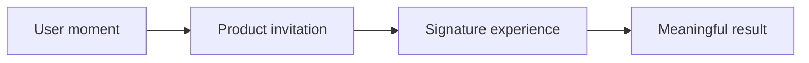

# Brainstorm: [Working title]

> Exploratory notes, not a specification
>
> Date: [YYYY-MM-DD]

[Use this as a menu, not a form. Delete, rename, reorder, or ignore anything
that does not help. Preserve unknowns and real tensions without filling them
with convenient assumptions.]

## The spark

[What is pulling us toward this idea? Describe the user moment, tension, change,
or opportunity in a few sentences.]

**A change we would love to create:** [Working thought.]

**Known people or moments:** [What evidence says about who encounters the
problem and when. Leave unknown when evidence is missing.]

**Known constraints:** [Only constraints that are truly non-negotiable.]

**Unknowns and provisional hypotheses:** [State what is unknown. Label any
hypothesis, why it may be useful, and what evidence would test it.]

## Field notes

[Collect observations from comparable products, adjacent fields, unexpected
analogies, industry knowledge, research, and direct experience.]

- **Reference or pattern:** [What was observed, why it is interesting, source,
  and date.]
- **Friction or anti-pattern:** [What seems repeatedly awkward or underserved.]
- **Relevant analogy:** [A model from another field, why the comparison holds,
  and what it may teach.]
- **Shift in the world:** [Technology, behavior, platform, regulation, or culture
  that changes the possibility space.]

## Questions worth answering

- What if [provocation]?
- What do we know about [material uncertainty]?
- Is [assumption] supported, or merely inherited?
- What becomes possible if [constraint or model changes]?
- What would make someone say, “[desired reaction]”?

## Possibilities

[Capture ideas that follow from the evidence or help examine a real uncertainty.
One strong possibility is enough; do not generate alternatives to fill space.]

- [Idea fragment]

## Direction: [Evocative working name]

**The grounding:** [Evidence, observation, or user intent this direction follows.]

**The hypothesis:** [Only if needed: what may be true and how it could be
tested.]

**The promise:** [What becomes possible for whom.]

**A moment that makes it real:** [A short scene, ritual, or interaction.]

**Possible shape:** [Capabilities, surfaces, access points, metaphor, or service
model—only enough to make the idea tangible.]

**Why it may be valuable:** [What is useful, distinct, timely, or resonant, and
how strongly that is supported.]

**What it says no to:** [Deliberate boundary or tradeoff.]

**Biggest unknown:** [Missing fact, provisional hypothesis, risk, or question.]

[Repeat only for alternatives that express a genuine unresolved choice. State
the choice that separates them.]

## Experience fragments

[Add any rough journey, page constellation, sample interaction, product voice,
notification, diagram, or before-and-after scene that helps someone feel the
idea.]

## Tensions worth preserving

- [Agency] versus [automation]: [Why both matter.]
- [Focus] versus [flexibility]: [What the tension reveals.]
- [Familiarity] versus [novelty]: [Where the product might choose differently.]

## Gentle pressure test

- **Unverified dependency:** [Claim or condition the idea relies on, current
  evidence, and how to test it.]
- **Possible harm or exclusion:** [Who or what could be poorly served.]
- **Familiar packaging:** [What is less differentiated than it first appears.]
- **Smallest expression with magic intact:** [A useful experiment or prototype.]

## Current synthesis

**What seems well supported:** [Facts, observations, and concept elements with
the strongest grounding.]

**Promising direction or live alternatives:** [Use one direction when the work
supports one. Keep multiple only when a real fork remains.]

**What remains unknown:** [Do not convert these gaps into assumptions.]

**Live forks:** [Choices that should remain open and the evidence needed to
resolve them.]

**Set aside, but learned from:** [Discarded idea and the insight it produced.]

**Next question, research task, or experiment:** [The highest-value way to
reduce uncertainty.]

**Seeds for a later specification:** [Concepts that feel stable enough to define
more rigorously next.]
