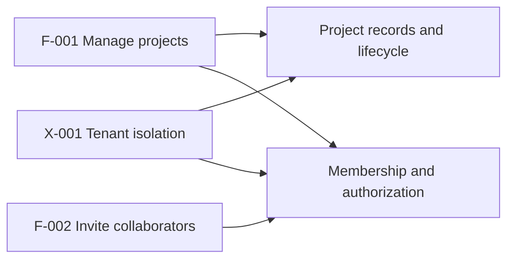
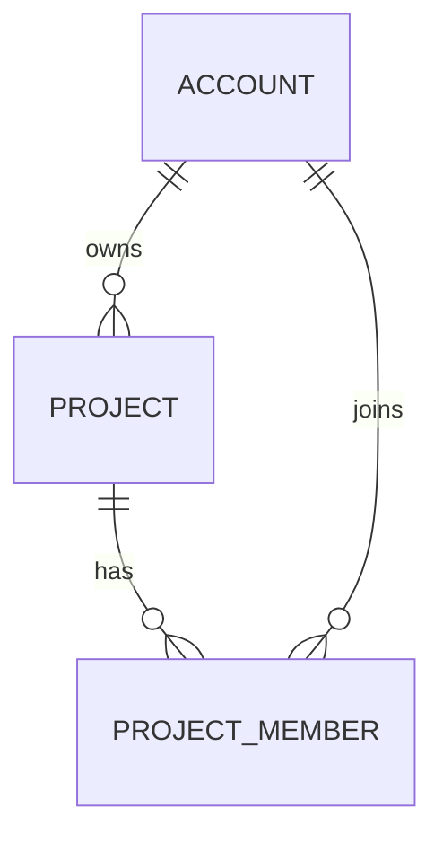
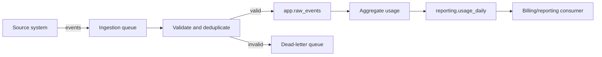

# Database Catalog: [Project name]

> Document: Target database catalog  
> Maturity: [Draft | Reviewed | Approved]  
> Database: [Engine and version]  
> Catalog owner: [Team or role]  
> Last verified: [YYYY-MM-DD]  
> Design basis: [Greenfield requirements | Existing-application evidence and requirements]  
> Evidence: [Product requirements, schema/migration paths, database introspection, workloads, and tests]

## 1. Product capabilities and database responsibilities

[Define the required product capabilities before describing the database. Use
stable feature IDs throughout the catalog. Describe user or business outcomes,
not screens, tickets, endpoints, tables, or implementation ideas.]

### Feature register

| ID | Product capability | Actors and outcome | Core actions and failure cases | Database responsibility | Critical invariants and authorization | Quality requirements |
| --- | --- | --- | --- | --- | --- | --- |
| F-001 | [Create and manage projects] | [Account owner creates a durable workspace for collaboration] | [Create, rename, archive; duplicate name, unauthorized actor, concurrent update] | [Own project identity, lifecycle state, membership, and audit facts] | [Only authorized members can read; only owners can archive] | [Read-after-write; expected scale; retention; audit need] |

Use **No database responsibility** when a feature requires no persistence,
database query, derived data, or database-enforced invariant.

### Cross-cutting product requirements

| ID | Requirement | Affected features | Database responsibility | Evidence |
| --- | --- | --- | --- | --- |
| X-001 | [Tenant isolation] | [F-001, F-002] | [Enforce tenant ownership and access at database boundaries] | [Product/security requirement] |

### Architecture drivers

[Derive only the decisions that materially shape ownership, boundaries, data
models, access paths, consistency, security, or operations.]

| ID | Feature / requirement refs | Driver | Database consequence | Evidence or target |
| --- | --- | --- | --- | --- |
| AD-001 | [F-001, X-001] | [Every tenant-owned read and write must be isolated] | [Tenant key participates in ownership, policies, and supporting indexes] | [Security requirement and expected workload] |

### Feature-to-data map

[When three or more feature-to-domain relationships are easier to understand
visually, include a small map. Show responsibilities, not tables. Remove this
diagram when the registers are clearer.]



## 2. Purpose and scope

[Describe what this target database supports, what the catalog covers, and what
is out of scope. Summarize the feature boundary established above.]

### Catalog design principles

- Keep one canonical statement of each fact. Cross-reference it elsewhere.
- Let names, types, constraints, and relationships carry meaning before adding
  explanatory prose.
- Add a database object or background process only for a concrete integrity,
  access, security, or operational need.
- Prefer fewer objects, states, owners, and asynchronous boundaries when they
  satisfy the same requirements.
- Keep global conventions here and object-specific decisions with their objects.
- Mark unresolved decisions `TBD`; do not fill gaps with speculative design.
- Remove optional rows and subsections that do not apply.
- Describe only the ideal steady state. Keep implementation gaps, rollout phases,
  compatibility work, and migration history in separate documents.

## 3. Global conventions

| Concern | Convention |
| --- | --- |
| Schemas/namespaces | [Schemas and their responsibilities] |
| Domain vocabulary | [Canonical term for each important concept and any deliberate boundary mappings] |
| Naming | [Apply the bundled naming rules; record the table-number convention and any engine/tool naming convention that overrides the deterministic fallback] |
| Primary keys | [Type, generation, and immutability] |
| Foreign keys | [Default update/delete policy and exceptions] |
| Time | [Type and time-zone policy] |
| Money and units | [Representation and rounding policy] |
| Nullability | [Meaning of `NULL` versus empty values] |
| Enumerated values | [Enum/domain/check-constraint policy] |
| Audit fields | [Creation/update actor and timestamp policy] |
| Deletion and retention | [Hard delete, soft delete, archival, retention] |
| Tenancy | [Tenant key and isolation rule, or not applicable] |
| Authorization | [Roles, grants, row-level security, ownership] |
| Sensitive data | [Classification, encryption, masking, logging rules] |
| Connection management | [Pooler, pool mode, limits, prepared statements, timeouts] |
| Transactions and locking | [Isolation, timeout, lock-order, advisory-lock rules] |
| Pagination and batching | [Cursor convention, batch/COPY limits, bulk failure policy] |
| Partitioning | [Decision threshold, partition creation and retention ownership] |
| Extensions | [Approved extensions, versions, schemas, and owners] |

### Open design decisions

| ID | Decision needed | Impact | Owner | Target date |
| --- | --- | --- | --- | --- |
| TBD-001 | [Question that must be answered] | [Objects or behavior affected] | [Owner or TBD] | [Date or TBD] |

## 4. Object inventory

### Schemas

| Schema | Purpose | Owner |
| --- | --- | --- |
| `[schema]` | [Responsibility] | [Database role/team] |

### Catalog objects

| Qualified name | Kind | Purpose | Feature / requirement refs | Design evidence |
| --- | --- | --- | --- | --- |
| `[schema.table_name]` | Table | [One sentence] | [F-001, X-001] | [Workload, invariant, or source evidence] |
| `[schema.function_name]` | Function/RPC | [One sentence] | [F-001] | [Workload, invariant, or source evidence] |
| `[schema.view_name]` | View | [One sentence] | [F-002] | [Workload, invariant, or source evidence] |
| `[schema.policy_or_trigger]` | [RLS policy/Trigger/Type/Sequence] | [One sentence] | [X-001] | [Workload, invariant, or source evidence] |

### Moving-parts justification

[List non-obvious or operationally costly mechanisms such as triggers,
materialized views, security-definer functions, partitions, extensions,
denormalized fields, advisory locks, queues, caches, and synchronization jobs.
Do not repeat straightforward tables, constraints, or indexes already justified
in their owning sections.]

| Mechanism | Feature / requirement refs | Concrete need | Evidence | Why a simpler design is insufficient | Owner | Failure cost | Review/removal trigger |
| --- | --- | --- | --- | --- | --- | --- | --- |
| `[reporting.project_summary materialized view]` | [F-006] | [Measured reporting need] | [Query plan, workload, or requirement] | [Why a normal view or indexed query is insufficient] | [Owner] | [Staleness or outage impact] | [Volume, latency, or product condition] |

## 5. Relationship model

[Include every direct table relationship. Split by bounded context when needed,
then include a small cross-context diagram.]



### Relationship register

| From | Columns | To | Cardinality and optionality | Enforcement | On update | On delete | Meaning |
| --- | --- | --- | --- | --- | --- | --- | --- |
| `[schema.child]` | `[parent_id]` | `[schema.parent(id)]` | [Each child has exactly one parent; a parent has zero or more children] | [Foreign key name, or unenforced with integrity owner] | [NO ACTION] | [CASCADE] | [Business meaning] |

## 6. Table catalog

[Repeat the following subsection for every table. Keep columns in declaration
order. Use exact database syntax for types and expressions.]

### `[schema.table_name]`

**Feature / requirement refs:** [F-001, X-001]

**Purpose:** [Why the table exists]  
**Why a separate table:** [Invariant, lifecycle, cardinality, or access need that
cannot be represented more simply]  
**Row meaning:** [What one row represents]  
**Owner:** [Role/team]  
**Lifecycle:** [Creation, mutation, deletion/retention]  
**Expected scale:** [Row count, row size, growth, and relevant data distribution]  
**Workload:** [Read/write mix, frequency, high-churn fields, and hot paths]  
**Partitioning:** [None with reason, or strategy, key, bounds, pruning queries,
creation/retention process, and owner]

#### Columns

| Ordinal | Column | Type | Nullable | Default / generated value | Description |
| ---: | --- | --- | :---: | --- | --- |
| 1 | `[id]` | `[uuid]` | No | `[gen_random_uuid()]` | [Stable row identifier.] |

For columns that need stricter semantics, add notes:

- `[column]`: [Units, time zone, allowed values, identifier format, empty versus
  null meaning, immutability, sensitivity, or other invariant.]

#### Constraints

| Name | Kind | Columns / expression | References | Update/delete action | Deferrable | Purpose |
| --- | --- | --- | --- | --- | :---: | --- |
| `[table_name_pkey]` | Primary key | `[id]` | — | — | No | [Row identity] |
| `[table_parent_id_fkey]` | Foreign key | `[parent_id]` | `[schema.parent(id)]` | `[ON UPDATE NO ACTION; ON DELETE CASCADE]` | No | [Relationship invariant] |
| `[table_value_check]` | Check | `[value >= 0]` | — | — | No | [Domain invariant] |

#### Indexes

| Name | Unique | Method / operator class | Keys / expressions | Include | Predicate | Supported access pattern | Cost / tradeoff |
| --- | :---: | --- | --- | --- | --- | --- | --- |
| `[table_parent_created_idx]` | No | `[btree]` | `[parent_id ASC, created_at DESC]` | `[status]` | `[deleted_at IS NULL]` | [Query, join, policy, or constraint supported] | [Write/storage cost and why justified] |

[Identify indexes created implicitly by primary/unique constraints. Do not imply
that a foreign-key index exists unless it does.]

#### Access patterns

| Pattern / consumer | Operation | Predicates and joins | Order / limit / cursor | Expected frequency and cardinality | Latency target | Supporting index or scan decision | Verification |
| --- | --- | --- | --- | --- | --- | --- | --- |
| [List active projects] | [Read] | `[account_id = ? AND deleted_at IS NULL]` | `[created_at DESC, id DESC; limit 50; cursor (created_at, id)]` | [Frequency and expected rows] | [Target] | `[projects_account_created_active_idx]` | [Measured plan or explicitly unverified target hypothesis] |

#### Mutation and concurrency patterns

| Mutation | Atomic operation / conflict target | Transaction boundary | Locks and acquisition order | Idempotency | Retry / conflict behavior |
| --- | --- | --- | --- | --- | --- |
| [Create or update setting] | [`INSERT ... ON CONFLICT (account_id, key)`] | [Single statement] | [None beyond statement locks] | [Natural or supplied key] | [Caller-visible result] |

#### Relationships

- Outbound: `[foreign key or unenforced relationship]` → `[qualified target]`;
  [cardinality, optionality, enforcement owner, and business meaning].
- Inbound: `[qualified source foreign key]` → `[key]`; [cardinality,
  optionality, and business meaning].

#### Access control

**RLS:** [Disabled with reason | Enabled | Enabled and forced]  
**Privileged bypasses:** [Owner, service role, or security-definer path and why]

| Policy | Command | Roles | `USING` | `WITH CHECK` | Supporting indexes | Purpose and tests |
| --- | --- | --- | --- | --- | --- | --- |
| `[table_select_policy]` | `[SELECT]` | `[authenticated]` | `[(select auth.uid()) = account_id]` | — | `[table_account_id_idx]` | [Allowed and denied cases] |

| Role | Schema usage | SELECT | INSERT | UPDATE | DELETE | Sequence/function rights | Reason |
| --- | :---: | :---: | :---: | :---: | :---: | --- | --- |
| `[app_role]` | Yes | Yes | Yes | [Columns or yes] | No | [Exact grants] | [Least-privilege need] |

#### Integrity and maintenance notes

[Document triggers, cross-object invariants, autovacuum/analyze needs, retention,
sensitive-data handling, full-text/JSONB behavior, and maintenance or monitoring
rules. Write "None" when there are no additional notes.]

## 7. Functions and RPCs

[Repeat for every database function and remotely exposed procedure.]

### `[schema.function_name]`

**Feature / requirement refs:** [F-001]

**Purpose:** [Operation and business outcome]  
**Why database-owned:** [Shared integrity, atomicity, authorization, or
data-local performance that justifies a database routine]  
**Exposure:** [Internal function | RPC name/route | Trigger-only]  
**Signature:** `[schema.function_name(parameter_name parameter_type, ...) returns return_type]`  
**Owner:** [Database role/team]  
**Security:** [Invoker/definer, required role/grant, row-level security behavior,
and fixed search path]  
**Runtime attributes:** [Language, volatility/determinism, null-input behavior,
parallel safety, and cost/rows where relevant]

#### Parameters

| Ordinal | Mode | Parameter | Type | Default | Description |
| ---: | --- | --- | --- | --- | --- |
| 1 | `[IN]` | `[account_id]` | `[uuid]` | — | [Meaning and validation] |

#### Return contract

| Column / value | Type | Nullable | Description |
| --- | --- | :---: | --- |
| `[result]` | `[jsonb]` | No | [Meaning and shape] |

**Reads:** [Qualified objects or none]  
**Writes:** [Qualified objects or none]  
**Transaction and side effects:** [Locks, emitted events, external effects, or none]  
**Errors:** [SQLSTATE/domain error, condition, and caller-visible behavior]  
**Consumers:** [Call sites, roles, services, or triggers]

## 8. Views

[Repeat for every regular and materialized view.]

### `[schema.view_name]`

**Feature / requirement refs:** [F-002]

**Kind:** [View | Materialized view]  
**Purpose:** [Consumer need]  
**Why a view:** [Why a named query boundary is clearer than a direct query; for a
materialized view, why stored results justify refresh and staleness machinery]  
**Row meaning:** [What one row represents]  
**Sources:** [Qualified tables, views, and functions]  
**Security:** [Owner, grants, invoker/barrier behavior, row-level security effects]  
**Consumers:** [Services, reports, APIs, or jobs]

#### Output columns

| Ordinal | Column | Type | Nullable | Source / expression | Description |
| ---: | --- | --- | :---: | --- | --- |
| 1 | `[id]` | `[uuid]` | No | `[source.id]` | [Meaning] |

**Filtering and aggregation:** [Predicates, grouping, deduplication, and join
semantics, or none]  
**Refresh:** [For a materialized view: owner, method, cadence/trigger,
concurrency, staleness target, and required unique index. Otherwise: not applicable.]

## 9. User flows and data pipelines

[Document the common flows needed to understand normal use and the important
flows with material authorization, financial, privacy, deletion, fan-out,
asynchronous, or failure consequences. Use exact backend object names. Do not
include speculative flows; mark unresolved contracts `TBD`.]

### Flow inventory

| Flow | Feature / requirement refs | Kind | Trigger | Actor/source | Backend outcome | Importance | Owner |
| --- | --- | --- | --- | --- | --- | --- | --- |
| [Create project] | [F-001] | User action | [Submitted form or API call] | [Authenticated account] | [Creates project and owner membership] | [Common primary path] | [Team/role] |
| [Usage rollup] | [F-006] | Data pipeline | [Schedule or event] | [Application events] | [Refreshes reporting aggregates] | [Billing/reporting dependency] | [Team/role] |

### User action: [Flow name]

**Feature / requirement refs:** [F-001, X-001]

**Purpose:** [User goal and business outcome]  
**Actor:** [User type or system actor]  
**Trigger:** [UI action, API request, webhook, or event]  
**Preconditions:** [Required state and authorization]  
**Success result:** [User-visible response and committed backend state]  
**Consistency:** [Immediate, read-after-write, or expected convergence window]  
**Owner:** [Team/role]

```mermaid
sequenceDiagram
    actor User
    participant App as Application
    participant API as Backend API
    participant DB as Database
    participant Queue as Job queue
    participant Worker as Worker

    User->>App: Submit project
    App->>API: POST /projects
    API->>DB: BEGIN; call rpc.create_project(...)
    DB-->>API: Project and membership committed
    API->>Queue: Enqueue project.created
    API-->>App: 201 Created
    Queue-->>Worker: Deliver project.created
    Worker->>DB: Record asynchronous result
```

#### Backend impact

| Step | Boundary/component | Operation | Objects read | Objects written | Transaction / consistency | Authorization and validation | Failure, retry, or side effect |
| ---: | --- | --- | --- | --- | --- | --- | --- |
| 1 | [Backend API] | [Validate request and resolve actor] | `[app.accounts]` | — | [Outside transaction] | [Required role and validation] | [Caller-visible error] |
| 2 | `[rpc.create_project]` | [Create project and membership] | `[app.accounts]` | `[app.projects]`, `[app.project_members]` | [One transaction; commit point] | [Database policy or routine check] | [Rollback on constraint failure] |
| 3 | [Worker] | [Process emitted event] | `[app.projects]` | `[app.audit_log]` | [Eventually consistent] | [Worker role] | [Idempotent retry and dead-letter path] |

#### Important variants and failures

- [Permission denied, validation failure, concurrency conflict, partial external
  failure, retry, cancellation, or compensating action.]

[Repeat the user-action subsection for each selected common or important flow.]

### Data pipeline: [Pipeline name]

**Feature / requirement refs:** [F-006]

**Purpose:** [Business use and consumers]  
**Why a pipeline:** [Why synchronous or direct database work cannot meet the
volume, latency, isolation, integration, or recovery requirement]  
**Source:** [System, stream, file, table, or API]  
**Trigger/cadence:** [Event, schedule, continuous stream, or manual run]  
**Destination:** [Qualified database object, service, warehouse, or external sink]  
**Freshness target:** [Maximum acceptable lag]  
**Delivery semantics:** [At-most-once, at-least-once, or effectively-once]  
**Owner:** [Team/role]



#### Stage contract and lineage

| Stage | Input | Processing / mapping | Objects read | Objects written | Output | Checkpoint / idempotency | Failure and recovery |
| ---: | --- | --- | --- | --- | --- | --- | --- |
| 1 | [Event and schema version] | [Validate, normalize, classify] | — | `[app.raw_events]` | [Accepted event] | [Event ID unique key] | [Reject or dead-letter] |
| 2 | `[app.raw_events]` | [Group and aggregate by account/day] | `[app.raw_events]` | `[reporting.usage_daily]` | [Daily usage row] | [Cursor/watermark and upsert key] | [Retry; replay from checkpoint] |

**Backfill/replay:** [Method, range controls, duplicate prevention, and approval]  
**Observability:** [Lag, throughput, error, dead-letter, and data-quality signals]  
**Sensitive-data handling:** [Classification changes, minimization, masking,
retention, and access boundary]  
**Failure impact:** [Affected features, maximum tolerable outage, and recovery owner]

[Repeat the data-pipeline subsection for each selected important pipeline.]

## 10. Operational rules

### Schema evolution and deployment

[State durable rules for safe future schema evolution, validation, rollback, and
zero-downtime deployment. Do not include a migration from any present design to
this target. Keep rollout phases, backfills, and compatibility windows in a
separate migration plan. For PostgreSQL, cover safe constraint validation,
concurrent index work, partition creation, and post-load `ANALYZE` where relevant.]

### Connection and workload management

| Client/workload | Role | Pooler and mode | Pool/connection limit | Prepared statements | Timeouts | Session requirements |
| --- | --- | --- | --- | --- | --- | --- |
| [Web API] | `[app_role]` | [PgBouncer transaction mode] | [Evidence-based limit] | [Unnamed/disabled as required] | [Statement, lock, idle transaction] | [None or exact reason for session mode] |

### Backup, retention, and recovery

[Recovery targets, backup scope, retention, archival, and deletion obligations.]

### Observability and maintenance

| Concern | Signal / query | Target or alert | Owner | Response |
| --- | --- | --- | --- | --- |
| Query workload | [`pg_stat_statements`] | [Frequent/high-total/high-mean threshold] | [Owner] | [Plan review process] |
| Query plans | [`EXPLAIN (ANALYZE, BUFFERS)`] | [Critical-query baseline] | [Owner] | [Regression response] |
| Table health | [Dead tuples and vacuum/analyze recency] | [Per-table target] | [Owner] | [Tune or manual maintenance] |
| Concurrency | [Deadlocks, lock waits, connection saturation] | [Target] | [Owner] | [Triage and remediation] |
| Pipelines | [Lag, data quality, dead-letter volume] | [Target] | [Owner] | [Replay/recovery] |

## 11. Completeness and verification

| Check | Result | Evidence |
| --- | --- | --- |
| Every in-scope feature defines its database responsibility, invariants, authorization, and quality requirements | [Pass/Fail/TBD] | [Feature register review] |
| Every feature with a database responsibility maps to flows and catalog objects | [Pass/Fail/TBD] | [Feature trace review] |
| Every catalog object traces to a feature or cross-cutting requirement | [Pass/Fail/TBD] | [Object inventory review] |
| Every schema object is in the inventory | [Pass/Fail/TBD] | [Source or command] |
| Every table and column is documented | [Pass/Fail/TBD] | [Source or command] |
| Every constraint and index is documented | [Pass/Fail/TBD] | [Source or command] |
| Every relationship agrees across tables and diagrams | [Pass/Fail/TBD] | [Review or command] |
| Every function/RPC signature and behavior is documented | [Pass/Fail/TBD] | [Source or command] |
| Every view output and dependency is documented | [Pass/Fail/TBD] | [Source or command] |
| Non-obvious moving parts have evidence, owners, and simpler alternatives considered | [Pass/Fail/TBD] | [Justification register and object sections] |
| Each fact has one canonical location without conflicting duplication | [Pass/Fail/TBD] | [Editorial review] |
| Database names follow the bundled rules and use one accurate domain term per concept | [Pass/Fail/TBD] | [Naming review] |
| Every important access pattern maps to an index or scan decision | [Pass/Fail/TBD] | [Plans, workload, or review] |
| Foreign-key and RLS predicate indexes are present or justified | [Pass/Fail/TBD] | [Catalog query or review] |
| Roles, grants, RLS policies, and privileged bypasses are explicit | [Pass/Fail/TBD] | [Grant/policy inspection] |
| Contended writes define transactions, lock order, and idempotency | [Pass/Fail/TBD] | [Flow and mutation review] |
| Connection pooling, timeouts, and maintenance have owners | [Pass/Fail/TBD] | [Configuration and runbook] |
| Common and important user flows show chronology and backend impact | [Pass/Fail/TBD] | [Requirements, traces, or review] |
| Important data pipelines show lineage and recovery behavior | [Pass/Fail/TBD] | [Jobs, orchestration, or review] |
| Target schema validation checks pass | [Pass/Fail/Not run] | [Command and result] |

### Known gaps

- [Use explicit `TBD` entries with impact and owner. Write "None" only after the
  completeness checks pass.]
