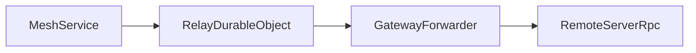
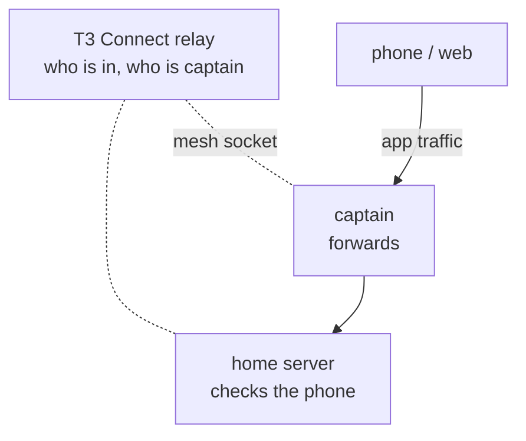

# File PR

A PR description is the permanent record of a change. Someone who never saw the work should learn in a minute what was broken, what changed, what now behaves differently, and why they should believe it works. Write it the way this skill is written: short sentences, plain words, the point first.

Start from the diff, not your memory of the session. Read it against the base branch, usually `origin/main`, and make sure every sentence you write is true of the code as it stands. If the repository has a PR template, use its headings in its order and fill them in the way this skill describes.

## Title

The title usually becomes the commit message. Use the repository's conventional commit format, with the app or package as the scope. The subject says what a user or developer will notice, not what you edited. Keep it near 70 characters.

BAD

> ❌ fix(web): add timeout to waitForProject in ImportStep

GOOD

> ✅ fix(web): onboarding import no longer hangs when the project never arrives

## Opening

Open with the problem as someone saw it, then the cause. Then say briefly how the change fixes it.

BAD

> ❌ Removed the `landingProject` state and its effect from `ImportStep` and switched the finish handler to `waitForProject`.

GOOD

> ✅ After importing projects, the welcome wizard could stay on "Importing…" forever. It waited for the project to reach the client, and sometimes it never did. Now it waits up to 10 seconds, then finishes either way.

## Pick a shape

A small, focused fix gets the short shape: three paragraphs and no headings. The first says what was wrong and why. The second says what changed, and what you left alone on purpose. The third starts with `Proof:` and says how you know it works.

Anything with several parts, a behavior change a reviewer could miss, or screenshots gets the full shape. Use these headings in this order, and leave out any section with nothing to say:

```md
## Problem

## Change

## What this improves

## Behavior changes

## Verification
```

A new feature or system gets the feature shape. Open with two short paragraphs: what is true today, then what this change makes true. Then give one heading per idea a reviewer must hold, named as a plain question or claim ("How machines get access", "Which machine is captain"). Each gets a few sentences and, where it helps, a diagram. End with `## Limits` as a table, `## What stays the same`, `## Proof`, and `## Not proven yet`. Put long proof detail in a `<details>` block.

## Problem

One or two sentences, or one short paragraph. Lead with the symptom, then the cause. If there is an issue, link it with `Fixes #123`.

## Change

Explain how the fix works. Name the files, functions, and components in backticks so a reviewer can find them. Use bullets for separate parts and prose for one. End with anything you left out on purpose and where it went.

## What this improves

One bullet per improvement. Each starts with a label and carries its own evidence.

BAD

> ❌ Fixed the onboarding bug and cleaned up some state.

GOOD

> ✅ Bug fix: the wizard finishes when the imported project never arrives. The new test `finishes setup without landing` fails on main.
>
> ✅ Removed: the effect that copied the landing project into state.

## Behavior changes

List every difference a user or caller can see, including the ones you'd rather not mention. Reviewers read this section most closely. Write each one as now and before.

BAD

> ❌ Improved error handling in the pairing form.

GOOD

> ✅ Pairing errors stay on the form. Before, they also showed on Home until the form closed.

## Verification

Each bullet is a command or check and what you saw. Show the new test failing on the base branch and passing here. Say what you couldn't check, and why.

BAD

> ❌ Tests pass.

GOOD

> ✅ `pnpm test apps/web/src/onboarding`: 3 passed. The new test fails with main's `WelcomeWizard.tsx`.
>
> ✅ Not checked on Android. No emulator was available.

For UI changes, put before and after screenshots side by side in a table. Add a short recording when motion or timing matters. Upload images to GitHub. Don't commit them.

## Diagrams

Most PRs need no diagram. Draw one only when a reviewer must picture several parts working together to judge the change, which usually means a new feature or system. A short-shape PR never gets one.

Write it as a `mermaid` block. GitHub renders it as a diagram, and it stays editable text. Pick the kind by the question it answers:

- `flowchart` shows who talks to whom.
- `sequenceDiagram` shows the order of messages. Number the steps.
- `stateDiagram-v2` shows how something moves through its states.

Keep each diagram to one idea; if it needs more boxes, split it. Label every box with the product's name for the thing, and add its role in a few words. Label every arrow. Put the diagram right after the sentence that introduces it, and follow it with the rule it shows.

BAD

````md

````

GOOD

````md
Clients send app traffic through the captain. The relay only tracks who is in the mesh.



The captain only forwards. Each machine still checks the client's own sign-in.
````

## Style

Be concrete. Quote the exact error text, the button label, and the count. Write about the code, not the session. A related PR gets one sentence and a link.

BAD

> ❌ This PR aims to improve the pairing experience. I first tried debouncing the input, but that didn't work.

GOOD

> ✅ Pairing errors from other screens no longer show on the Add environment form.

Before you submit, read the title and description once more for secrets and private details.

## Example

```md
Clicking the simulator in the Device panel drew a blue focus ring around the whole pane. That ring is noise when you are just grabbing the phone.

The ring now uses `focus-visible:` instead of `focus:`. Clicking shows nothing. Tabbing to the screen still shows the ring, so keyboard users can see where keys go.

| Click, before | Click, after | Tab, after |
| --- | --- | --- |
|  |  |  |

Proof: a browser test on `DeviceStreamView` reads the ring's box-shadow. On main, clicking gives the ring. Here, clicking gives `none` and Tab still gives the ring. `pnpm lint` and `pnpm typecheck` pass.
```
